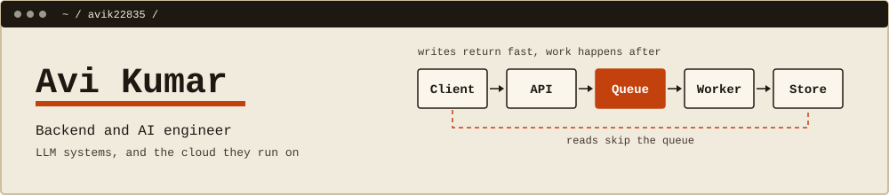

  <picture>
    <source media="(prefers-color-scheme: dark)" srcset="assets/banner-dark.svg">
    
  </picture>

 

I build LLM systems and the backend and cloud they run on, and I ship them deployed, not as demos. My focus is making them faster, cheaper to run and harder to break.

**Now:** building [GraphMem](https://github.com/avik22835/graphmem), a context API for LLM agents. 
**Open to:** full-time roles and internships, remote or on-site.

[Portfolio](https://YOUR-PORTFOLIO-URL) · [LinkedIn](https://www.linkedin.com/in/avi-kumar-250478363/) · [Resume](https://YOUR-RESUME-URL)

---

## Projects

| Project | What it does | Built with | Result |
|:--|:--|:--|:--|
| [**GraphMem**](https://github.com/avik22835/graphmem) | Context-management API for LLM agents. Stores chats as a graph and returns only the relevant nodes, ranked inside a token budget. | Python, FastAPI, AWS (ECS, SQS, Lambda), pgvector, Neptune | About 65% less context than sending full history. Writes return in about 10 ms. |
| [**ClickSense v3**](https://github.com/avik22835/clicksense) | Chrome extension that guides a person one step at a time on any site: it names the exact element and says why. | FastAPI, Gemini, Redis, MiniLM | Repeat tasks drop from 3–8 s to under 50 ms with a three-layer cache. |
| [**Jarvis AI**](https://github.com/avik22835/jarvis-ai) | Shared codebase assistant. A team ingests a repo once and everyone queries one knowledge base. | Django, Elasticsearch, Gemini, Cloud Run | 15+ languages. Hybrid BM25 and kNN search with reranking. |
| [**polyglot-intel**](https://github.com/avik22835/polyglot-intel) | MCP server that gives coding agents tools over a real call graph of a multi-language codebase. | Tree-Sitter, MetaCall, Docker, MCP | 8 languages. Each live call runs in its own subprocess. |

## Open source

| Project | PR | What changed | Status |
|:--|:--|:--|:--|
| [metacall/core](https://github.com/metacall/core) | [#738](https://github.com/metacall/core/pull/738) | An idempotent RubyGems release pipeline: tests on Ubuntu, macOS and Windows gate tag-triggered releases, and the upload step skips versions already published. Also Windows-only DLL loading and CI fixes. | ✓ Merged |

## Ledger

Every pull request, commit and build from my public activity. This section rebuilds itself every six hours, so open and closed pull requests show up here too, not only merged ones.

<!--LEDGER:START-->
**Pull requests to other projects** (every state, newest first within each)

| Project | PR | What it does | Status | Date |
|:--|:--|:--|:--|:--|
| [metacall/core](https://github.com/metacall/core) | [#738](https://github.com/metacall/core/pull/738) | Automated Ruby Gem release pipeline and Cross Platform CI fixes | ✓ Merged | 12 Apr 2026 |
| [metacall/core](https://github.com/metacall/core) | [#684](https://github.com/metacall/core/pull/684) | modernize python release workflow with oidc (#14) | ✗ Closed, not merged | 21 Mar 2026 |
| [metacall/protocol](https://github.com/metacall/protocol) | [#56](https://github.com/metacall/protocol/pull/56) | Feature/malicious logic test | ✗ Closed, not merged | 21 Mar 2026 |
| [metacall/protocol](https://github.com/metacall/protocol) | [#57](https://github.com/metacall/protocol/pull/57) | Feature/malicious logic test | ✗ Closed, not merged | 21 Mar 2026 |
| [metacall/core](https://github.com/metacall/core) | [#775](https://github.com/metacall/core/pull/775) | Feature/test cpp fix | ✗ Closed, not merged | 18 Apr 2026 |

**Latest commits** (public, across my repos)

_No recent public commits._

**Latest build on each project**

| Project | Build | Last run |
|:--|:--|:--|
| [graphmem](https://github.com/avik22835/graphmem) | [✓ Passing](https://github.com/avik22835/GraphMem/actions/runs/35578092363) | 21 Sep 2026 |
| [clicksense](https://github.com/avik22835/clicksense) | ○ No workflow runs yet | - |
| [jarvis-ai](https://github.com/avik22835/jarvis-ai) | ○ No workflow runs yet | - |
| [polyglot-intel](https://github.com/avik22835/polyglot-intel) | ○ No workflow runs yet | - |
<!--LEDGER:END-->

## Stack

**Languages** Python, JavaScript, SQL, Bash, C, C++ 
**Backend** FastAPI, Django, Node.js, Celery 
**Data** PostgreSQL with pgvector, Elasticsearch, Redis, Neptune 
**Cloud** AWS (ECS, Lambda, SQS), GCP Cloud Run, Docker, GitHub Actions 
**AI** RAG, vector search, MCP, LangGraph, Gemini, AWS Bedrock

---

Questions about any project are welcome. The fastest way to reach me is LinkedIn.
